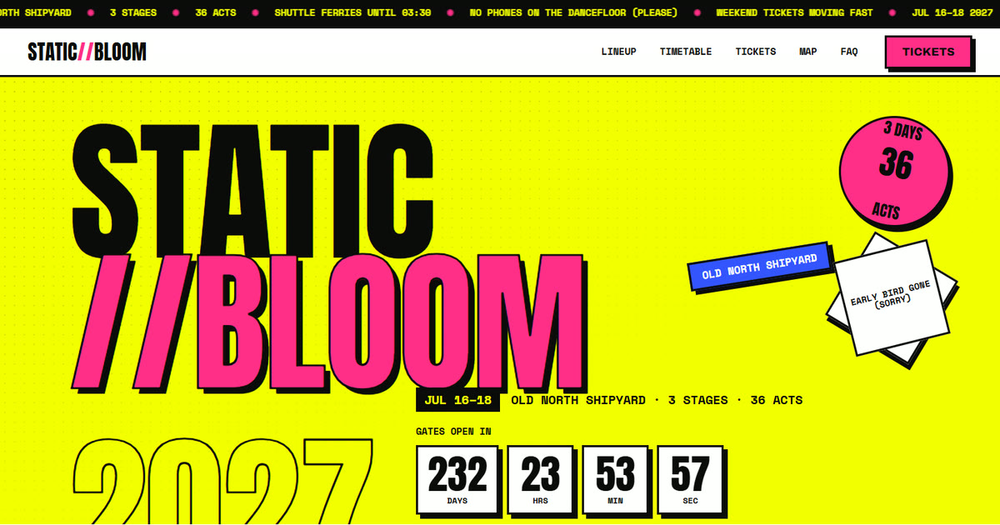

# STATIC//BLOOM 2027

A website for a fictional three-day electronic music festival in an old shipyard.
Neo-brutalist design: hot pink, acid yellow, thick black borders and hard offset shadows.

**Live site:** https://minty-web.github.io/4/



## What's inside

- **Live countdown** to the gates opening
- **Lineup and timetable** rendered from one data set: 36 acts over three days and three stages, with accessible day tabs
- **"My plan"**: tap sets to save them on your device (`localStorage`); clashing sets are flagged automatically
- **Ticket picker** with quantity steppers, a live total and an order limit, ending in a demo checkout dialog (`<dialog>`) that makes clear nothing was charged
- **Interactive site map** in SVG: hover or tap the legend to highlight stages, bars, camping and the ferry pier
- Scrolling news ticker, wobbling stickers, halftone background, FAQ and newsletter sign-up
- Responsive and keyboard friendly; animations switch off for reduced motion

## Built with

Plain HTML, CSS and JavaScript. No frameworks, no build step.
Fonts: [Anton](https://fonts.google.com/specimen/Anton), [Archivo](https://fonts.google.com/specimen/Archivo) and [Space Mono](https://fonts.google.com/specimen/Space+Mono).

```
index.html    page structure and content
styles.css    brutalist components and layout
script.js     festival data, countdown, timetable, plan, tickets, map
favicon.svg   logo mark
```

## Run it locally

Open `index.html` in a browser, or serve the folder:

```bash
npx serve .
```

---

STATIC//BLOOM, its lineup and its shipyard are fictional; no tickets are sold. Concept site designed and built by [minty-web](https://github.com/minty-web).
